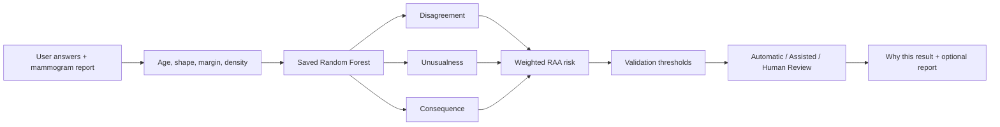
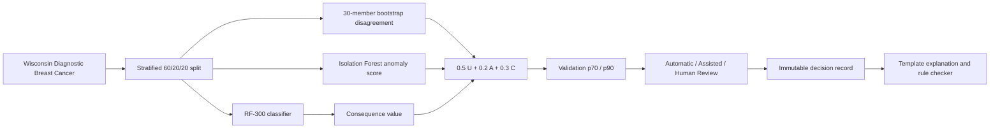

# Risk Aware Abstention System

This project demonstrates classification, uncertainty, anomaly scoring, consequence-weighted risk, and Automatic / Assisted / Human Review routing. Its original WDBC paper experiment is preserved separately from the user-facing mammogram report estimator.

## Run the local app

Requirements: Python 3.11+, uv 0.13.5, and GNU Make.

```sh
make setup
make app
```

Open http://localhost:8501. The dark app loads a saved model and does not train while the page loads. The server binds to IPv6 loopback (::1), so it is reachable only on this computer.

## User questions and result

The form asks age, height, weight, gender, family history, prior breast condition/biopsy/treatment, and four symptom questions. If the user has a mammogram report, the app also asks for mass shape, edge (margin), and density in plain language.

The model uses only age and the three mammogram report findings. Height, weight, gender, symptoms, and history are report context only and do not change the estimate. Without a mammogram report, the result is Human Review with no benign/malignant estimate. If any report field is marked Not sure, the saved TRAIN-only imputer completes the model input and the RAA route is set to Human Review.

The result separates the model's mass-label estimate from the RAA route. It explains the estimate with one-field sensitivity checks and shows disagreement, unusualness, consequence, risk, and validation thresholds. The local language model runs only when the user requests a report; inputs are not sent to a hosted service or saved automatically.

## User-facing dataset and held-out check

The app uses the public [UCI Mammographic Mass dataset](https://archive.ics.uci.edu/dataset/161/mammographic+mass), licensed CC BY 4.0. It contains 961 mammogram masses (516 benign, 445 malignant). The model uses age, shape, margin, and density; BI-RADS is excluded because UCI marks it non-predictive. Missing training fields are imputed with statistics fitted on TRAIN only.

The seed-42 split has 576 TRAIN, 192 validation, and 193 held-out TEST records. On that one test split, accuracy was 73.1%, malignant sensitivity 61.8%, benign specificity 82.7%, and AUROC 0.810. At the configured p70/p90 policy, 130 cases were Automatic with a 20.0% error rate; 10 of 34 malignant false negatives were in that tier. These numbers come from `results/mammographic_mass/metrics.json`. They show this small, older dataset is not suitable for health decisions.

Build or rebuild the saved model with `make mammography-artifact`. The data source, feature schema, split, and model hash are in `results/mammographic_mass/manifest.json`.

## Reproduce the paper experiment

`make reproduce` runs the original WDBC experiment and writes split metrics, ablations, sensitivity tables, risk-coverage results, synthetic-shift analyses, explanation-checker results, and figures under `results/runs/<run-id>/`. It is kept separate from the mammography input model.



## Latest source-aligned experiment


Run raa-20261026-paper-aligned-01 used 30 stratified splits (seeds 0-29), for 3,420 pooled test rows, with Python 3.13.17 and scikit-learn 1.9.1. The run artifacts are under results/runs/raa-20261026-paper-aligned-01/.

| Metric | Independent source-aligned run | Journal paper |
| --- | ---: | ---: |
| Baseline errors | 142/3,420 (4.15%); 86 false negatives | 142/3,420 (4.15%); 86 false negatives |
| Automatic coverage | 70.41% | 70.7% |
| Automatic-case errors | 13/2,408 (0.54%) | 17/2,419 (0.70%) |
| Baseline false negatives routed away | 73/86 (84.9%) | 70/86 (81.4%) |
| Isolation Forest stress AUROC | 0.912 ± 0.020 | 0.911 ± 0.019 |
| Explanation checker | 570/570 injected faults detected; 0/114 clean false positives | All listed faults detected |

The pooled baseline error count matches the paper, while several policy and synthetic-shift results differ. The independent run is reported as its own result; parameters were not tuned to force agreement. See [the reconciliation](docs/state/RECONCILIATION.md), [method](docs/method.md), [results](docs/results.md), and [limitations](docs/limitations.md).

## Pipeline



## 90-second viva walkthrough

**0:00-0:15:** Explain the project: it produces a model lean and a separate Automatic, Assisted, or Human Review route.

**0:15-0:35:** Enter age, family and previous breast history, and the four symptom answers. Point out that symptom and history responses are report context, not model predictors.

**0:35-0:55:** Select that a mammogram report is available and enter its shape, edge, and density. The model estimate and route update from those actual report fields.

**0:55-1:15:** Explain the one-field score comparisons, uncertainty, unusualness, consequence, and risk thresholds. Missing report fields are imputed from TRAIN and force Human Review.

**1:15-1:30:** Show the optional locally generated report and read its held-out metrics. State that this small, older dataset does not establish clinical performance.

## Claim boundaries and privacy

- The model estimates the dataset's mammographic mass severity label; it does not diagnose a person.
- Height, weight, gender, symptoms, and history do not change the model score. Without mammogram report details, the app returns Human Review without a class estimate.
- On the seed-42 test split, malignant sensitivity was 61.8%; the Automatic tier error rate was 20.0%. This is unsuitable for real health decisions.
- The separate WDBC paper experiment remains the source of the original research results. Those values are not from the mammography input model.
- No fairness, clinical safety, or deployment claim is supported.
- The local report writer runs on this computer only when the user asks for a report. The app does not save answers or reports unless the user downloads the report.

## Project map

- **src/raa/mammography.py**: UCI data loader, train-only preprocessing, saved mammogram classifier, RAA decisions, and local sensitivity explanations.
- **src/raa/app/health_intake.py**: dark questionnaire, result rendering, and user-requested report flow.
- **data/mammographic_masses.data**: UCI Mammographic Mass source data; license/source notes are in data/README.md.
- **results/mammographic_mass/**: saved model bundle, manifest, held-out metrics.
- **results/runs/**: separate WDBC paper-aligned experiment artifacts.
- **docs/state/**: project status, decisions, blockers, reconciliation, and source map.

## Report generation

Click **Generate prediction report** after viewing the result. The local Ollama model receives the submitted answers and structured prediction facts on this computer only; it writes a short report summary. The report also includes the exact model output, route, scores, explanations, and held-out metrics from the saved results file. If Ollama is unavailable, the app uses a fixed summary. The report is formatted as a Word `.docx` file, kept in memory, and offered as a download; it is not saved automatically.

Start the app with `make app` and open http://localhost:8501.
