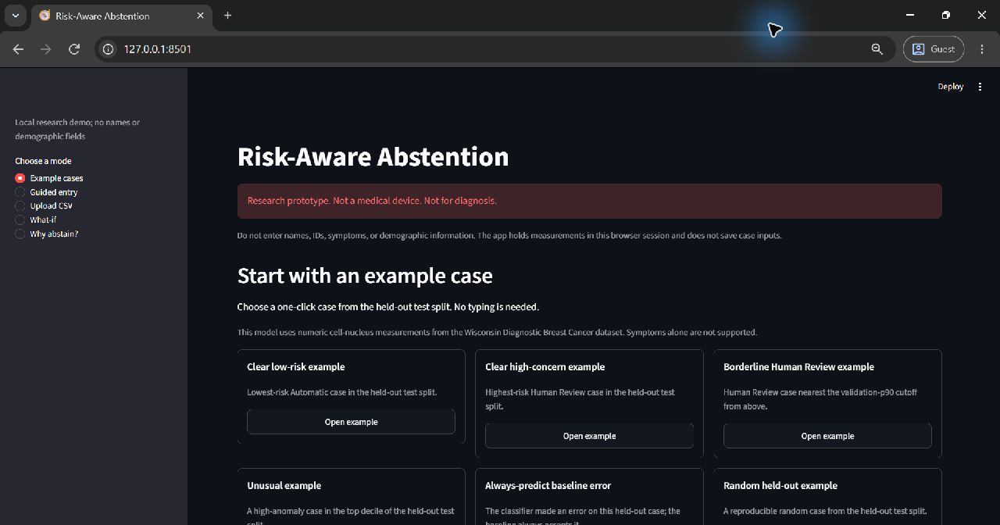
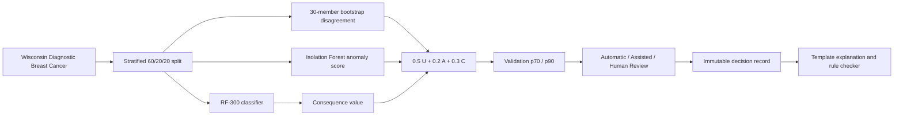

# Risk-Aware Abstention

A research prototype that combines a Random Forest classifier, bootstrap disagreement, anomaly scoring, consequence-weighted risk, three-level routing, and deterministic explanations.

> **Research prototype. Not a medical device. Not for diagnosis.** This project has no evidence for clinical use, fairness, calibrated error probabilities, or deployment safety.

## Run the local demo

Requirements: Python 3.11 or newer, uv 0.13.5, and GNU Make.

From the repository root:

```sh
make setup
make app
```

Open [http://127.0.0.1:8501](http://127.0.0.1:8501). The default four-question intake does not call the cancer classifier. On submission, a local Ollama model may draft a status-only explanation and the app offers a downloadable text report; the LLM sees only fixed status facts, not your answers. The report records Human Review with no prediction made. Optional WDBC research modes load the committed model bundle at results/demo/model_bundle.joblib; the app does not train models when a page loads. The Make target binds to 127.0.0.1. To rebuild the bundle intentionally, run make demo-artifact.

If GNU Make is unavailable, use the equivalent commands:

```sh
uv sync --locked
uv run streamlit run src/raa/app/streamlit_app.py --server.headless=true --browser.gatherUsageStats=false --server.address=127.0.0.1
```

Run tests and lint with make test and make lint, or equivalent commands uv run pytest -q and uv run ruff check .

To regenerate experiment outputs, run make reproduce. It writes split metrics, ablations, sensitivity tables, risk-coverage results, synthetic-shift analyses, explanation-checker results, and figures under results/runs/<run-id>/.

## Start with four user inputs

The landing page asks for age, symptoms, family history, and medical history. All four fields start unanswered. The current Random Forest was trained on cell-nucleus measurements and cannot use these answers. After all four are supplied, the only output is **Human Review — no prediction made**. A candidate dataset was evaluated, but its held-out results were too poor to connect to this form.

## Why the questionnaire does not produce a cancer estimate

The [Duke BRCA dataset](https://stat.duke.edu/datasets/brca) has 987 historical screening records. It records age bands, family history, prior breast biopsy/surgery, and only lump or nipple-discharge symptoms. Its target is whether a cancer diagnosis was recorded within 12 months after a 2002 screening mammogram; it is not a current diagnosis or a benign/malignant pathology label. It contains 37 positive outcomes.

An RAA model trained on a fixed seed-42 stratified split (591 train, 198 validation, 198 held-out test) detected **0 of 7** test cancer outcomes and had **0.487 ROC-AUC**. The candidate is therefore kept out of the intake app. Reproduce the audit with `python scripts/audit_questionnaire_dataset.py`; metrics are in `results/clinical_candidate_audit/metrics.json`. These are one-split research results, not clinical validation.



## Intake and research modes

| Mode | What you do | What the app does |
| --- | --- | --- |
| **Four-question intake** (landing page) | Enter age; choose Lump, Breast swelling, Skin changes, Nipple changes, or No symptoms; answer Yes, No, or Not sure for family history and medical history. | Requires all four answers and then returns **Human Review — no prediction made**. The answers are not passed to the current classifier because it was not trained or validated on these fields. |
| **Guided entry** (WDBC research mode) | Enter six mean cell-nucleus measurements using sliders or blank number boxes. Typical training ranges and plain-language help are shown. | Displays **6 of 30 measured, 24 estimated**. Assessment waits until all six values are supplied; a KNN imputer fitted on TRAIN only estimates the remaining 24 before the WDBC inference pipeline runs. |
| **Upload CSV** | Upload or paste rows with all 30 WDBC feature columns; use the downloadable header template. | Validates and triages at most 100 rows in memory. The table gives route, risk, and reason; a summary gives each tier's share; downloaded results omit the input feature values. |
| **What-if** | Adjust four measurements on a held-out WDBC profile for exploration, or request a synthetic unusualness stress case. Use Guided entry for new WDBC measurements. | Recomputes the WDBC inference pipeline when values change. The stress button applies the configured signed 3-standard-deviation shift to eight features and labels the case synthetic. |
| **Example cases** (optional) | Open one of six held-out test cards when deliberately selecting this mode. | Runs that test row through the WDBC pipeline. An optional control reveals the recorded test label. |
| **Why abstain?** | Review the experiment summary. | Loads reported figures from results/runs/raa-20261026-paper-aligned-01/metrics.json. |

The collapsible **Review capacity (exploratory)** control is available with WDBC case results. Its default preserves the validation p70/p90 thresholds. Other capacities map to percentiles of saved validation risks and affect only the displayed route for that case; they do not change the canonical experiment results.

## Reading a result

- For the four-question intake, Human Review means the current model cannot assess those inputs. It is not a malignant/benign classification, medical assessment, or referral.
- In the optional WDBC research modes, the route uses an icon **and** text: Automatic, Assisted, or Human Review. Wording says “the model leans …”; it is not a diagnosis.
- Three signal bars show model disagreement, unusualness, and the design value called cost of error. The risk gauge shows the current WDBC score and route thresholds.
- A template explanation has a checker status. The checker is read-only and cannot alter a WDBC class or route.
- Guided entry states how many fields were measured and estimated. Range and approximate-geometry checks produce warnings; they do not silently change measured values.
- The displayed WDBC risk is **R = 0.5U + 0.2A + 0.3C**, using the project's normalization rules. Default routing thresholds are validation percentiles 70 and 90.

Bootstrap disagreement is not a calibrated probability of error. The WDBC model's imputer is TRAIN-only, but its uncertainty score does not quantify additional imputation uncertainty. Synthetic anomaly tests do not establish real-world distribution-shift performance.

## Latest source-aligned experiment

Run raa-20261026-paper-aligned-01 used 30 stratified splits (seeds 0-29), for 3,420 pooled test rows, with Python 3.13.17 and scikit-learn 1.9.1. The run artifacts are under results/runs/raa-20261026-paper-aligned-01/.

| Metric | Independent source-aligned run | Journal paper |
| --- | ---: | ---: |
| Baseline errors | 142/3,420 (4.15%); 86 false negatives | 142/3,420 (4.15%); 86 false negatives |
| Automatic coverage | 70.41% | 70.7% |
| Automatic-case errors | 13/2,408 (0.54%) | 17/2,419 (0.70%) |
| Baseline false negatives routed away | 73/86 (84.9%) | 70/86 (81.4%) |
| Isolation Forest stress AUROC | 0.912 ± 0.020 | 0.911 ± 0.019 |
| Explanation checker | 570/570 injected faults detected; 0/114 clean false positives | All listed faults detected |

The pooled baseline error count matches the paper, while several policy and synthetic-shift results differ. The independent run is reported as its own result; parameters were not tuned to force agreement. See [the reconciliation](docs/state/RECONCILIATION.md), [method](docs/method.md), [results](docs/results.md), and [limitations](docs/limitations.md).

## Pipeline



## 90-second viva walkthrough

**0:00–0:15 — State the purpose.** “This prototype offers a four-question intake, but the current research model cannot classify those answers. It will not guess Malignant or Benign.”

**0:15–0:35 — Show the questions.** Enter age, choose one symptom option, and answer the family-history and medical-history questions. Point out that no answer is preselected.

**0:35–0:50 — Explain the output.** Select **Review answers**. The page reports **Human Review — no prediction made** and explains that the Random Forest expects cell-nucleus measurements. This is an unsupported-input status, not a diagnosis or referral.

**0:50–1:10 — Show the compatible research mode.** Select **Guided entry** and explain that it accepts WDBC cell measurements, not the four intake answers. Six measured fields are supplied and 24 are estimated by the saved TRAIN-only imputer.

**1:10–1:30 — Close with requirements and limits.** “A compatible labeled dataset and a separately trained and validated model are needed before these four inputs could support Malignant or Benign outputs. The prototype is not clinically validated.”

## Claim boundaries and privacy

- The four-question intake does not generate a clinical risk estimate or malignant/benign prediction.
- The current Random Forest uses the Wisconsin Diagnostic Breast Cancer dataset from scikit-learn: 569 rows and 30 numeric cell-nucleus features. It cannot use age, symptoms, family history, or medical history.
- A compatible labeled dataset and a separately trained and validated model are required before predictions from these four fields can be considered.
- Do not claim fairness, clinical safety, diagnosis, or deployment readiness.
- The synthetic anomaly stress test is not validation on real-world shifted data.
- Explanations in the WDBC research modes are deterministic templates; no live language model was evaluated.
- Do not enter names, IDs, or contact details. The local app keeps submitted inputs in memory for the session and does not save them to disk. The four intake answers are not passed to the existing classifier. This is not a security certification.

## Project map

- **src/raa/**: dataset, models, risk policy, inference API, explanations, experiments, and Streamlit app.
- **config.yaml**: model settings, seeds, risk weights, policy percentiles, and stress recipe.
- **results/demo/**: saved model bundle, manifest, feature importance, examples, and validation risks used by the app.
- **results/runs/**: run-ID-versioned experiment artifacts and metrics.
- **docs/state/**: project status, decisions, blockers, reconciliation, and [paper source map](docs/state/SOURCE_MAP.md).
- **docs/images/raa-demo.jpg**: screenshot of the running app's default four-question intake.
- **legacy/**: documents that the initial workspace contained no unrelated implementation to quarantine.


## Local LLM status explanation and report

The intake uses the local Ollama API at 127.0.0.1:11434 with qwen2.5:1.5b by default. Set OLLAMA_MODEL to another installed local model if needed. The app does not send questionnaire answers or cell measurements to the LLM. It asks the model only to rephrase the fixed Human Review/no-prediction status. A safety gate rejects output that omits that status or adds disease or medical claims; the report then uses a fixed explanation. The LLM is exploratory and has not been clinically or scientifically evaluated.

After submitting all four fields, use Download intake result report to save a plain-text report. It includes the answers because the user explicitly downloads it. The app does not write the report or submitted answers to disk. If Ollama is not running or the configured model is missing, the intake and report still work with the fixed explanation.

To start the demo, run make app and open http://127.0.0.1:8501. The server binds only to the local computer. Keep the Ollama service running for the LLM-generated summary.
