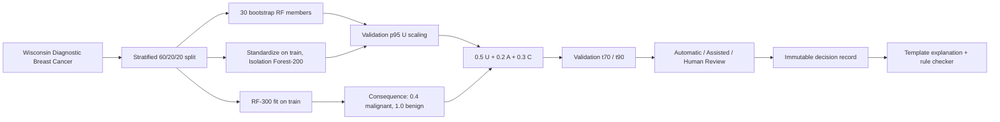

# Risk-Aware Abstention

A research prototype combining Random Forest classification, bootstrap disagreement, Isolation Forest anomaly scoring, consequence-weighted risk, three-level routing, and deterministic grounded explanations.

> **Research prototype only.** This system is not clinically validated and must not be used for real diagnosis. It establishes no fairness, clinical safety, calibrated error probability, or live-LLM reliability claim.

## Latest reproduction

The author's journal paper and five background papers are now in the project evidence record. Implementation details that the journal specifies have been aligned; unspecified random generator details remain documented assumptions. Run `raa-20261026-paper-aligned-01` used 30 stratified splits (seeds 0-29), 3,420 test rows, Python 3.13.17, and scikit-learn 1.9.1. Results are stored in `results/runs/raa-20261026-paper-aligned-01/`.

| Metric | Reproduced | Journal paper |
| --- | ---: | ---: |
| Baseline errors | 142/3,420 (4.15%); 86 false negatives | 142/3,420 (4.15%); 86 false negatives |
| Automatic coverage | 70.41% | 70.7% |
| Automatic-case errors | 13/2,408 (0.54%) | 17/2,419 (0.70%) |
| Baseline false negatives routed away | 73/86 (84.9%) | 70/86 (81.4%) |
| Isolation Forest stress AUROC | 0.912 ± 0.020 | 0.911 ± 0.019 |
| Explanation checker | 570/570 injected faults detected; 0/114 clean false positives | All listed faults detected |

The run matches the reported pooled baseline exactly and closely matches several error-ranking and stress AUROCs. It differs in the accepted-error count, main-split assisted/human allocation, and combined-risk behavior under synthetic shift. The differences are explicit in [the reconciliation](docs/state/RECONCILIATION.md); no parameter was tuned to match a target.

## Quickstart

Requirements: Python 3.11 or newer, Git, GNU Make, and `uv` 0.13.5. Install `uv` once with `python -m pip install uv==0.13.5`, then run:

```sh
make setup
make test
make reproduce
make app
```

If GNU Make is unavailable, the equivalent PowerShell commands are:

```powershell
uv sync --locked
uv run python -m pytest -q
uv run ruff check .
uv run python -m raa.cli reproduce --run-id raa-local-run
uv run streamlit run src/raa/app/streamlit_app.py
```

The reproduction command writes split metrics, ablations, sensitivity analysis, risk-coverage tables, synthetic-shift stress outputs, explanation fault injection, JSON metrics, and PNG figures under `results/runs/<run-id>/`.

## Pipeline



The paper's stated settings are described in [the method](docs/method.md). Bootstrap standard deviation is a disagreement signal, not a probability that a prediction is wrong. The anomaly score is tested only on the documented synthetic perturbation.

## Claim boundaries

- The contribution is the integration of known components, three-level routing, ablation results, grounded explanations, and coverage/workload analysis.
- Do not claim novel Random Forests, Isolation Forests, bootstrap uncertainty, or selective classification.
- Do not claim fairness: this dataset has no demographic attributes.
- Do not call the synthetic stress result real-world OOD validation.
- Explanations are deterministic templates. No live LLM was evaluated.
- This project provides no clinical safety or deployment evidence.

## Project map

- `src/raa/`: dataset, models, risk policy, explanation checker, experiments, visualizations, and demo.
- `config.yaml`: model settings, seeds, weights, policy cutoffs, and stress recipe.
- `uv.lock`: locked dependency resolution.
- `docs/state/`: project status, decisions, handoff, reconciliation, and [paper source map](docs/state/SOURCE_MAP.md).
- `results/runs/`: run-ID-versioned experiment artifacts.
- `legacy/`: records that the initial workspace contained no unrelated implementation to quarantine.
