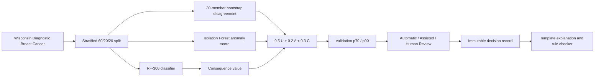

# Risk-Aware Abstention

A research prototype that combines a Random Forest classifier, bootstrap disagreement, anomaly scoring, consequence-weighted risk, three-level routing, and deterministic explanations.

> **Research prototype. Not a medical device. Not for diagnosis.** This project has no evidence for clinical use, fairness, calibrated error probabilities, or deployment safety.

## Run the local demo

Requirements: Python 3.11 or newer, uv 0.13.5, and GNU Make.

From the repository root:

```sh
make setup
make app
```

Open [http://localhost:8501](http://localhost:8501). The app loads the committed model bundle at results/demo/model_bundle.joblib; it does not train models when a page loads. To rebuild that bundle intentionally, run make demo-artifact.

If GNU Make is unavailable, use the equivalent commands:

```sh
uv sync --locked
uv run streamlit run src/raa/app/streamlit_app.py --server.headless=true --browser.gatherUsageStats=false
```

Run tests and lint with make test and make lint, or equivalent commands uv run pytest -q and uv run ruff check .

To regenerate experiment outputs, run make reproduce. It writes split metrics, ablations, sensitivity tables, risk-coverage results, synthetic-shift analyses, explanation-checker results, and figures under results/runs/<run-id>/.

## Start with an example

The landing page is designed for a first result with one click. It uses cases from the held-out seed-42 TEST split, so you can explore the real pipeline without typing measurements.


## Five input modes

| Mode | What you do | What the app does |
| --- | --- | --- |
| **Example cases** (landing page) | Open one of six labeled example cards. | Runs the held-out row through the classifier, uncertainty, anomaly, consequence, risk, routing, and explanation. An optional control reveals the recorded test label. |
| **Guided entry** | Enter six mean measurements using sliders or number boxes. Typical training ranges and plain-language help are shown. | Displays **6 of 30 measured, 24 estimated**. A KNN imputer fitted on TRAIN only estimates the other 24 features before the complete inference pipeline runs. |
| **Upload CSV** | Upload or paste rows with all 30 WDBC feature columns; use the downloadable header template. | Validates and triages at most 100 rows in memory. The table gives route, risk, and reason; a summary gives each tier's share; downloaded results omit the input feature values. |
| **What-if** | Adjust four measurements on a held-out profile, or request a synthetic unusualness stress case. | Recomputes the real inference pipeline when values change. The stress button applies the configured signed 3-standard-deviation shift to eight features and labels the case synthetic. |
| **Why abstain?** | Review the experiment summary. | Loads reported figures from results/runs/raa-20261026-paper-aligned-01/metrics.json. |

The collapsible **Review capacity (exploratory)** control is available with case results. Its default preserves the validation p70/p90 thresholds. Other capacities map to percentiles of saved validation risks and affect only the displayed route for that case; they do not change the canonical experiment results.

## Reading a result

- The route uses an icon **and** text: Automatic, Assisted, or Human Review. The wording says “the model leans …”; it is not a diagnosis.
- Three signal bars show model disagreement, unusualness, and the design value called cost of error. The risk gauge shows the current score and route thresholds.
- A template explanation has a checker status. The checker is read-only and cannot alter a class or route.
- For guided entry, the result states how many fields were measured and estimated. Range and approximate-geometry checks produce warnings; they do not silently change measured values.
- The displayed risk is **R = 0.5U + 0.2A + 0.3C**, using the project's normalization rules. The default routing thresholds are the 70th and 90th percentiles of validation risk.

Bootstrap disagreement is not a calibrated probability of error. The model bundle's imputer is TRAIN-only, but the uncertainty score does not explicitly quantify the additional uncertainty introduced by imputation. The anomaly evaluation uses synthetic perturbations and does not establish performance on real-world distribution shifts.

## Latest source-aligned experiment

Run raa-20261026-paper-aligned-01 used 30 stratified splits (seeds 0-29), for 3,420 pooled test rows, with Python 3.13.17 and scikit-learn 1.9.1. The run artifacts are under results/runs/raa-20261026-paper-aligned-01/.

| Metric | Independent source-aligned run | Journal paper |
| --- | ---: | ---: |
| Baseline errors | 142/3,420 (4.15%); 86 false negatives | 142/3,420 (4.15%); 86 false negatives |
| Automatic coverage | 70.41% | 70.7% |
| Automatic-case errors | 13/2,408 (0.54%) | 17/2,419 (0.70%) |
| Baseline false negatives routed away | 73/86 (84.9%) | 70/86 (81.4%) |
| Isolation Forest stress AUROC | 0.912 ± 0.020 | 0.911 ± 0.019 |
| Explanation checker | 570/570 injected faults detected; 0/114 clean false positives | All listed faults detected |

The pooled baseline error count matches the paper, while several policy and synthetic-shift results differ. The independent run is reported as its own result; parameters were not tuned to force agreement. See [the reconciliation](docs/state/RECONCILIATION.md), [method](docs/method.md), [results](docs/results.md), and [limitations](docs/limitations.md).

## Pipeline



## 90-second viva walkthrough

**0:00–0:15 — State the purpose.** “This prototype decides when to return a model lean automatically and when to route a case for assistance or human review. It is a research demo, not a diagnostic system.”

**0:15–0:35 — Show a one-click result.** Keep **Example cases** selected and open **Clear low-risk example**. Point to the route label, model lean, three signal bars, risk thresholds, and explanation checker.

**0:35–0:50 — Show abstention.** Open **Borderline Human Review example**. Explain that the route comes from the validation-derived risk thresholds and that the template only explains the recorded decision.

**0:50–1:05 — Show the real-input constraint.** Select **Guided entry**. Point out the six mean measurements and the note that six are measured while 24 are estimated by a TRAIN-only imputer.

**1:05–1:20 — Show evidence.** Select **Why abstain?** and identify the run ID and summary values loaded from the saved results file. State that the independent run differs from some published numbers and is reported separately.

**1:20–1:30 — Close with limits.** “The model lean, risk, and routing are not medical advice. The dataset and synthetic stress test do not establish clinical validity, fairness, or real-world shift performance.”

## Claim boundaries and privacy

- The dataset is the Wisconsin Diagnostic Breast Cancer dataset exposed by scikit-learn, with 569 rows, 30 numeric features, and no demographic attributes.
- Do not claim fairness, clinical safety, diagnosis, or deployment readiness.
- The synthetic anomaly stress test is not validation on real-world shifted data.
- Explanations are deterministic templates; no live language model was evaluated.
- Do not enter names, IDs, symptoms, or demographic information. The app keeps measurements in the browser session and does not save submitted case inputs to disk. This privacy statement describes the local demo implementation; it is not a security certification.

## Project map

- **src/raa/**: dataset, models, risk policy, inference API, explanations, experiments, and Streamlit app.
- **config.yaml**: model settings, seeds, risk weights, policy percentiles, and stress recipe.
- **results/demo/**: saved model bundle, manifest, feature importance, examples, and validation risks used by the app.
- **results/runs/**: run-ID-versioned experiment artifacts and metrics.
- **docs/state/**: project status, decisions, blockers, reconciliation, and [paper source map](docs/state/SOURCE_MAP.md).
- **docs/images/raa-demo.jpg**: screenshot of the running example-first app.
- **legacy/**: documents that the initial workspace contained no unrelated implementation to quarantine.
