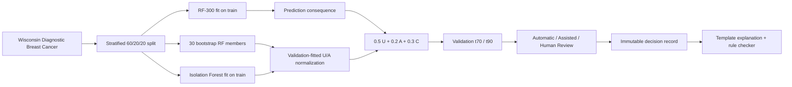

# Risk-Aware Abstention

An uncertainty-aware methodological prototype that combines Random Forest classification, bootstrap disagreement, anomaly scoring, consequence-weighted risk, three-level routing, and deterministic grounded explanations.

> **Research prototype only.** This system is not clinically validated and must not be used for real diagnosis. It does not establish fairness, clinical safety, calibrated error probabilities, or validated live-LLM explanations.

## Reproduction status

The workspace initially contained no implementation, paper, data archive, or prior result files. This repository is therefore a fresh implementation from the supplied specification. The first logged run is `raa-20261025-01`; its output is in `results/runs/raa-20261025-01/`. The paper's original methods and exact values could not be checked against a paper file.

| Metric | Paper target | Reproduced value |
|---|---:|---:|
| RF error rate | ≈4.15% | 4.064% pooled (split 95% CI 3.480–4.708%) |
| Automatic-case error rate | ≈0.70% | 1.493% pooled (split 95% CI 1.058–1.894%) |
| Automatic coverage | ≈70.7% | 68.538% pooled (split 95% CI 66.579–70.643%) |
| Baseline false negatives routed away from Automatic | ≈81% | 90.588% pooled (77/85) |
| Synthetic-shift Isolation Forest AUROC | ≈0.91 | 0.731 pooled across 12 variants (paired case-bootstrap 95% CI 0.709–0.758); 0.921 (0.882–0.957) for 10 features shifted by 2σ |
| Uncertainty-only selective accuracy | ≈99.39% | 99.301% (split 95% CI 98.973–99.597%) |
| Full-policy selective accuracy | ≈99.30% | 98.507% pooled (split 95% CI 98.106–98.942%) |
| Explanation checker detection | Numeric figure not provided in prompt | 100% (12/12); clean false-positive rate 0% (0/2) |

See [the results record](docs/results.md) and [paper reconciliation](docs/state/RECONCILIATION.md). The uncertainty-only ablation exceeds the full policy by 0.783 percentage points on paired splits. No target has been tuned or silently substituted.

## Quickstart

Requirements: Python 3.11 or newer, Git, GNU Make, and `uv` 0.13.5. Install `uv` once with `python -m pip install uv==0.13.5`, then run:

```sh
make setup
make test
make reproduce
make app
```

`make setup` syncs the locked dependencies from `uv.lock`. `make reproduce` creates a timestamped run directory containing the 30-split results, ablations, sensitivity analysis, risk-coverage tables, synthetic-shift stress test, explanation fault injection, JSON metrics, and PNG figures. The demo is local and uses the same training and validation split as the configured seed.

Useful focused commands are `make ablate`, `make stress`, `make explain-eval`, and `make lint`.

## Pipeline



For every split, all models are fitted only on the training partition. Component normalization and the 70th/90th percentile thresholds are fitted using validation data. The held-out test partition is used only for final metrics. The bootstrap ensemble's standard deviation of `P(malignant)` is a predictive-uncertainty signal, not a calibrated probability of error. Isolation Forest scores are negated so larger scores indicate more unusual observations.

The supplied prompt did not include consequence values or a source paper. This implementation records the explicit assumption `C(predicted malignant)=0` and `C(predicted benign)=1`; these are design values, not clinically derived costs. Bootstrap members use 50 trees each because the prompt only specified that they be smaller Random Forests. See ADRs in [DECISIONS.md](docs/state/DECISIONS.md).

## What to claim

- The contribution is the integration of the components, the three-level policy, the ablation including negative findings, the grounded explanation interface that cannot change routing, and coverage/workload analysis.
- Do not claim novel Random Forest, Isolation Forest, bootstrap uncertainty, or selective classification methods.
- Do not claim fairness: this dataset contains no demographic attributes. Tumor-size quantiles, if analyzed, are non-demographic proxies.
- Anomaly AUROC applies only to the documented synthetic feature-shift stress test.
- Explanations are deterministic templates checked against structured decision records; there is no validated live-LLM result.

## Repository map

- `src/raa/`: dataset, models, risk policy, explanation checker, experiments, visualizations, and demo.
- `config.yaml`: hyperparameters, seeds, consequence assumptions, risk weights, and thresholds.
- `uv.lock`: exact dependency resolution.
- `docs/state/`: handoff, task tracking, environment, decisions, progress, and reconciliation.
- `results/runs/`: generated, run-ID-versioned outputs.
- `legacy/`: documents that no unrelated legacy code was present to quarantine.

The reported-results path in this repository is `src/raa/eval/run_experiments.py` called by `make reproduce`. Since no original repository was available, this is not claimed to be the original paper's implementation path.
