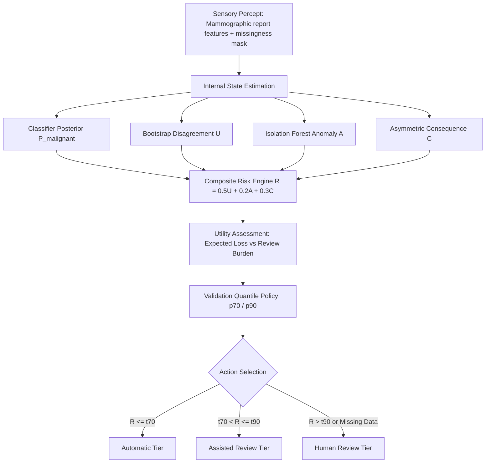

# Syllabus-Aligned Agent Architecture and Ethics Analysis

## 1. Overview and Problem Formulation

Risk-Aware Abstention (RAA) is formulated as an autonomous **utility-based decision agent** operating in a safety-critical clinical triage domain. Unlike standard classifiers that output a raw class label or uncalibrated probability, an RAA agent explicitly monitors its own epistemic boundaries, assesses potential harm, and selects one of three distinct actions:
1. **Automatic acceptance**: The system commits to the prediction autonomously because estimated clinical risk is sufficiently low.
2. **Assisted review**: The system provides the model lean alongside flagged uncertainty and anomaly indicators for clinician verification.
3. **Human review (abstention)**: The system declines autonomous decision-making and escalates the entire case to qualified medical professionals.

---

## 2. Agent Architecture in the Russell & Norvig AI Framework

In the standard artificial intelligence taxonomy (Russell & Norvig, *Artificial Intelligence: A Modern Approach*), agents are categorized along a capability continuum:
- **Simple reflex agents**: Act solely on current percepts without memory or goals.
- **Model-based reflex agents**: Maintain internal state reflecting unobserved aspects of the world.
- **Goal-based agents**: Evaluate actions based on whether they achieve a binary goal.
- **Utility-based agents**: Weigh trade-offs among conflicting objectives using an explicit scalar utility function.

### 2.1 The RAA System as a Utility-Based Agent

RAA operates as an **epistemically grounded utility-based agent**. The agent does not simply maximize prediction accuracy; rather, it maximizes **expected clinical and organizational utility** by balancing:
1. The diagnostic value of accurate early classification.
2. The catastrophic loss of an unflagged false negative (missed malignancy).
3. The cognitive load and economic cost imposed on clinical review staff.
4. The epistemic duty to acknowledge uncertainty and novel inputs.

### 2.2 Mathematical State and Decision Policy

Let $\mathbf{x} \in \mathcal{X} \subset \mathbb{R}^d$ be the patient feature vector, $\mathbf{m} \in \{0, 1\}^d$ be the missingness mask, and $y \in \{0, 1\}$ be the true ground-truth status ($0 = \text{malignant}, 1 = \text{benign}$).

1. **Percept**: $\mathbf{p} = (\mathbf{x}, \mathbf{m})$.
2. **Internal Epistemic State**:
   $$\mathbf{s} = \left(\hat{p}(\text{malignant} \mid \mathbf{x}), \, U(\mathbf{x}), \, A(\mathbf{x}), \, C(\hat{y})\right)$$
   where:
   - $\hat{p}(\text{malignant} \mid \mathbf{x})$ is the random forest ensemble posterior.
   - $U(\mathbf{x}) = \sigma_{\text{bootstrap}}\left(\hat{p}_b(\text{malignant} \mid \mathbf{x})\right)$ is predictive disagreement across 30 bootstrap resamples.
   - $A(\mathbf{x}) = -\text{score}_{\text{IsolationForest}}(\mathbf{x})$ represents data unusualness.
   - $C(\hat{y})$ is the asymmetric clinical consequence: $C = 1.0$ if $\hat{y} = \text{benign}$ (protecting against false negatives), $C = 0.4$ if $\hat{y} = \text{malignant}$.
3. **Composite Risk**:
   $$R(\mathbf{x}) = 0.5 \cdot \tilde{U}(\mathbf{x}) + 0.2 \cdot \tilde{A}(\mathbf{x}) + 0.3 \cdot \tilde{C}(\hat{y})$$
   where tildes denote parameters normalized on training/validation distributions.
4. **Action Space**: $\mathcal{A} = \{\text{Automatic}, \text{Assisted}, \text{Human Review}\}$.
5. **Decision Policy**:
   $$\pi(\mathbf{x}, \mathbf{m}) = \begin{cases}
   \text{Human Review} & \text{if } \sum m_i > 0 \text{ (epistemic missingness override)} \\
   \text{Automatic} & \text{if } R(\mathbf{x}) \le t_{70} \\
   \text{Assisted} & \text{if } t_{70} < R(\mathbf{x}) \le t_{90} \\
   \text{Human Review} & \text{if } R(\mathbf{x}) > t_{90}
   \end{cases}$$

---

## 3. PEAS Task Environment Specification

The formal task environment is characterized using the PEAS framework:

| Dimension | Specification | Clinical & System Rationale |
|---|---|---|
| **Performance Measure (P)** | • Selective accuracy in Automatic tier $\ge 99\%$ (or high safety threshold) • False negative catch rate $\ge 80\%$ routed away from automatic acceptance • Capacity budget adherence ($\le 30\%$ human review workload) • Zero confabulation / 100% rule-checker pass rate on explanations | Evaluates whether the system achieves patient safety while avoiding clinician cognitive overload. |
| **Environment (E)** | • Clinical mammography screening and diagnostic pathway • Asynchronous intake of patient cases with variable findings • Underlying histological truth latent until biopsy | Real-world clinical workflows where imaging occurs prior to surgical pathology. |
| **Actuators (A)** | • Tripartite routing dispatcher: emits $\text{action} \in \mathcal{A}$ • Dual explanation generator: class attribution + route risk breakdown • Immutable audit log generator: serialized decision record | Dispatches work to appropriate clinical queues without executing irreversible medical procedures. |
| **Sensors (S)** | • Input feature receptors: Age, Mass Shape, Mass Margin, Tissue Density • Missingness detectors ($m_i \in \{0, 1\}$) • Out-of-bounds range validators ($1 \le \text{Age} \le 120$) | Digitally captures standardized radiology report features. |

### 3.1 Environment Properties

- **Partially Observable**: The agent senses radiological descriptors (macro-features), but the microscopic cellular histology and genomic subtype are unobserved.
- **Stochastic**: Inter-radiologist terminology variability, biological tumor heterogeneity, and bootstrap ensemble stochasticity render the state transitions probabilistic.
- **Episodic**: Each patient assessment forms an isolated decision episode. The agent's decision on Patient $A$ does not alter the biological ground truth of Patient $B$.
- **Static**: The patient's mammogram does not change while the algorithm computes its inference.
- **Continuous Percepts, Discrete Actions**: Sensory features (age, probabilities, unusualness scores) are real-valued, whereas the routing decision is discrete (3 tiers).

---

## 4. Multi-Framework Ethical Analysis

The ethical defensibility of the RAA agent cannot be established by a single moral lens. Below, its choices are rigorously analyzed through **Utilitarian**, **Deontological**, and **Virtue Ethics** perspectives.

### 4.1 Utilitarian Perspective (Consequentialism)

*Core Axiom: An action is morally right if it maximizes net aggregate well-being and minimizes aggregate suffering.*

1. **Operationalizing Asymmetric Harm**: In breast cancer screening, false negatives and false positives have profoundly unequal consequences. A false negative (classifying a malignant lesion as benign) delays biopsy, allowing tumor growth, metastatic spread, and increased mortality. A false positive produces acute emotional distress and unnecessary biopsy, which is harmful but non-fatal. The RAA agent embeds this directly: predicting benign assigns $C = 1.0$, whereas predicting malignant assigns $C = 0.4$. Consequently, potentially malignant cases that have even modest uncertainty exceed $t_{70}$ and are escalated to Assisted or Human Review.
2. **Resource-Constrained Welfare Optimization**: Healthcare systems operate under finite specialist capacity. If an AI system referred 100% of cases for urgent human review, radiologists would experience acute fatigue, leading to increased human error rates and treatment backlogs. By safely triaging low-risk cases ($R \le t_{70}$) to Automatic acceptance, the agent frees scarce clinical specialist hours for complex, ambiguous cases, optimizing population-level health outcomes.

### 4.2 Deontological Perspective (Duty-Based Ethics & Kantianism)

*Core Axiom: Moral agents have categorical duties to adhere to moral laws (the Categorical Imperative), treating humans as ends in themselves and never merely as means. Certain actions are intrinsically impermissible regardless of utility outcomes.*

1. **The Duty of Epistemic Honesty**: A machine learning model is an inductive statistical estimator, not an omniscient authority. Presenting high-uncertainty guesses as definitive truths violates the duty of veracity. The RAA agent respects this duty by decomposing its risk into explicit components: it tells the clinician, *"The model leans Malignant, but disagreement $U = 0.38$ is high; this prediction cannot be trusted automatically."*
2. **The Duty of Non-Usurpation (Licensure and Scope of Practice)**: Autonomous medical diagnosis is restricted by law and morality to qualified human physicians who bear legal and moral accountability. The RAA agent refuses to diagnose:
   - System prompts and templates explicitly declare: *"This is a model estimate of mammographic mass severity, not a clinical diagnosis."*
   - Prohibited diagnostic phrasing is strictly enforced by rule-based and regex checkers.
3. **Respect for Patient Autonomy**: Deception or false reassurance compromises patient autonomy. By routing borderline cases to human clinicians, the system ensures patients are not denied informed consent through automated dismissal.

### 4.3 Virtue Ethics Perspective (Aristotelian Phronesis)

*Core Axiom: Ethical behavior reflects the character and practical wisdom (phronesis) of the agent, embodying virtues such as intellectual humility, temperance, prudence, and diligence.*

1. **Intellectual Humility (Epistemic Self-Knowledge)**: The defining virtue of the RAA system is knowing what it does not know. When presented with out-of-distribution inputs (e.g., an unusual combination of age and margin detected by the Isolation Forest) or incomplete reports, the agent does not guess. It exhibits epistemic modesty by declining to issue an autonomous prediction.
2. **Prudence (Phronesis in Threshold Setting)**: Reckless algorithms maximize raw throughput metrics to claim high "autonomous efficiency." The RAA agent exhibits prudence by calibrating its thresholds against empirical validation percentiles ($p70$ and $p90$), ensuring that conservative safety margins protect patients against edge cases.
3. **Diligence**: The agent enforces dual independent explanations (class attribution separated from routing risk) and subjects generated summaries to rule checkers before presenting results to human stakeholders.

---

## 5. Summary Table: Ethical Perspectives Comparison

| Ethical Lens | Primary Moral Concern | How RAA Implements It | Example System Decision |
|---|---|---|---|
| **Utilitarianism** | Minimizing total population harm and maximizing clinical resource efficiency. | Asymmetric loss penalty ($C=1.0$ for predicting benign); workload-aware validation thresholding. | Escalating a borderline benign-leaning scan to Human Review to avoid a catastrophic missed cancer. |
| **Deontology** | Categorical duty of truthfulness, epistemic candor, and respecting clinical scope boundaries. | Explicit uncertainty disclosure; strict refusal to emit diagnostic claims; rule-based checker gating. | Refusing to provide an automated diagnosis and declaring: *"Model estimate only; disagreement U is elevated."* |
| **Virtue Ethics** | Cultivating intellectual humility, practical wisdom (phronesis), and diligence. | Isolation forest novelty detection; epistemic abstention on missing data; rigorous explanation checks. | Abstaining entirely when an input field is marked *"Not sure / not listed"*, prioritizing humility over hubris. |
