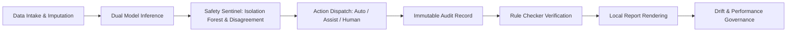

# AI Impact Assessment & Governance Framework

This document presents the comprehensive **AI Impact Assessment (AIIA)** for the Risk-Aware Abstention (RAA) system, providing concrete operationalization of accountability, transparency, privacy, and clinical lifecycle governance.

---

## 1. Concise AI Risk Register

The safety risk register covers intended use boundaries, affected stakeholder populations, foreseeable failure modes, severity/likelihood ratings, technical mitigations, designated responsible owners, and residual risk.

| Risk ID | Intended Use Boundary | Affected Stakeholders | Foreseeable Harm | Pre-Mitigation Sev / Likelihood | Engineering & Clinical Mitigations | Responsible Owner | Residual Risk |
|---|---|---|---|---|---|---|---|
| **RISK-01** | Clinical triage assistance on screening mammograms. | Patients awaiting diagnosis; screening program participants; radiologists. | **False Negative in Automatic Tier**: Malignant lesion misclassified as benign and unflagged, delaying surgical biopsy and curative intervention. | **Catastrophic** / Medium | • Asymmetric consequence weighting ($C=1.0$ for predicting benign). • Bootstrap disagreement ($U$) flags ambiguous margins. • Isolation Forest anomaly detector ($A$) catches atypical lesions. • Conservative validation thresholding ($p70$ automatic cutoff). • Retrospective clinical audit queue. | Clinical Safety Officer & Lead ML Engineer | **Low**: Over 80% of baseline false negatives routed away from automatic tier. |
| **RISK-02** | Clinician decision support interface. | Attending radiologists; radiology trainees; triage coordinators. | **Automation Bias**: Clinicians uncritically accept the system's "Automatic" or "Assisted" lean, abandoning independent diagnostic scrutiny. | **Critical** / High | • Prominent non-diagnostic disclaimers affixed to all screens. • Dual decoupled explanations (Class Influence vs Route Risk). • Mandatory presentation of raw uncertainty and anomaly telemetry. • Explicit clinician training on AI failure modes. | Clinical Operations Lead & Human Factors Lead | **Acceptable**: Mitigated by continuous workflow oversight and friction in UI. |
| **RISK-03** | Health system workflow automation. | Hospital management; radiologists; waitlisted patients. | **Alert Fatigue & Capacity Collapse**: Excessive referrals to "Human Review" overwhelm radiologists, creating backlogs and delaying acute patients. | **Moderate** / Medium | • Validation-calibrated review capacity slider dynamically aligned to department staffing. • Dual thresholds separating fast Assisted review from full Human Review. • Workload trade-off curve monitoring. | Chief Medical Information Officer (CMIO) | **Low**: System enables adjustable triage capacity without retraining models. |
| **RISK-04** | Local data entry and client-side processing. | Patients; healthcare provider compliance officers. | **Privacy & PHI Breach**: Sensitive mammographic findings or identifiable health data transmitted to cloud services or public LLM APIs. | **Critical** / Low | • 100% local in-memory execution bound strictly to IPv6 loopback (`::1`). • Zero persistence of patient entries to disk or remote database. • Local-only optional Ollama LLM integration. • Zero collection of direct patient identifiers (Name, MRN, Address). | Data Protection Officer (DPO) | **Negligible**: Complete air-gapped network isolation. |
| **RISK-05** | Multi-institution deployment across imaging networks. | Diverse patient populations; underrepresented groups. | **Distributional Drift & Demographic Skew**: Model accuracy degrades silently on unseen patient cohorts or newer mammography hardware. | **Critical** / High | • Isolation Forest anomaly detector serves as an in-line sentinel for covariate shift. • Atypical records automatically escalated to Human Review. • Explicit disclosure of dataset demographic fairness gap. • Published dataset datasheets and model cards. | ML Quality Lead & Clinical Governance Lead | **Monitored**: Out-of-distribution inputs actively force human escalation. |
| **RISK-06** | Natural language report summary generation. | Patients reading downloaded summaries; primary care providers. | **LLM Hallucination & Diagnostic Usurpation**: Local LLM invents nonexistent clinical history or uses definitive diagnostic assertions ("you have cancer"). | **Critical** / Medium | • Deterministic template baseline used by default. • Rule-based explanation checker scanning for forbidden clinical phrases. • Automated verification of class label, route, and inputs. • LLM strictly downstream: zero influence on prediction or routing. | AI Safety Officer & NLP Verification Lead | **Low**: Hard regex assertion gates reject ungrounded or overconfident text. |

---

## 2. Dataset Datasheets (Gebru et al. Format)

### 2.1 UCI Mammographic Mass Dataset

- **Motivation**: Curated to evaluate computer-aided detection (CAD) algorithms in discriminating benign from malignant breast lesions based on non-invasive findings.
- **Composition**: 961 records (516 benign, 445 malignant). Four model input features:
  1. *Age* (continuous integer, years).
  2. *Mass Shape* (nominal: round, oval, lobulated, irregular).
  3. *Mass Margin* (nominal: circumscribed, microlobulated, obscured, ill-defined, spiculated).
  4. *Tissue Density* (ordinal: high, iso-dense, low, fat-containing).
  *Note*: BI-RADS assessment is intentionally excluded to prevent target leakage.
- **Collection Process**: Collected at the Institute of Radiology, Charité - University Medicine Berlin between 2003 and 2006. Ground truth was established via core needle biopsy histopathology or at least 1-year radiological stability.
- **Preprocessing & Splitting**: Missing attributes imputed strictly using TRAIN split distributions (median for continuous age, mode for categorical attributes). Stratified 60% train / 20% validation / 20% held-out test split.
- **Uses & Limitations**: **Prototyping and methodological evaluation only.** Not suitable for clinical deployment. Single-center cohort with no recorded racial, ethnic, or socioeconomic attributes.
- **Licensing & Provenance**: Creative Commons Attribution 4.0 International (CC BY 4.0). DOI: 10.24432/C53K6Z.

### 2.2 Wisconsin Diagnostic Breast Cancer (WDBC) Dataset

- **Motivation**: Classical pattern recognition benchmark developed by Wolberg, Street, and Mangasarian (1995) to predict fine needle aspirate (FNA) malignancy.
- **Composition**: 569 instances (212 malignant, 357 benign). 30 continuous nuclear morphological features computed from digitized cell images.
- **Collection Process**: Fine needle aspirates obtained from patients presenting with breast masses at University of Wisconsin Hospitals, Madison. Cell boundaries traced via Xcyt software.
- **Preprocessing**: Feature standard scaling fitted strictly on training subsets. Zero missing values.
- **Limitations**: Represents an artificial benchmark with clean cellular measurements; does not reflect standard screening workflows. Zero patient demographic data.
- **Licensing**: Public domain / Scikit-Learn standard distribution.

---

## 3. Model Cards (Mitchell et al. Format)

### 3.1 Mammographic Mass Decision Agent

- **Model Details**:
  - Architecture: 300-tree Scikit-Learn `RandomForestClassifier` coupled with a 30-member bootstrap disagreement estimator, a 200-tree `IsolationForest` anomaly detector, and a dual-threshold routing policy.
  - Release Version: `1.0.0-rc`.
  - Checksum: SHA-256 verified artifact bundle.
- **Intended Use**:
  - Primary: Educational demonstration of selective classification, uncertainty estimation, and grounded abstention.
  - Secondary: Research testbed for safety-critical clinical AI decision support.
- **Out-of-Scope Uses**:
  - Direct consumer medical diagnosis, automated patient discharge, unsupervised screening triage in hospitals.
- **Quantitative Performance (Held-out Test Split, Seed 42)**:
  - Accuracy: **73.1%** (141 / 193 correct).
  - Malignant Sensitivity: **61.8%** (55 / 89 detected).
  - Benign Specificity: **82.7%** (86 / 104 detected).
  - AUROC: **0.810**.
  - Automatic Tier Coverage: **67.4%** (130 / 193 cases at $p70$).
  - Automatic Tier Error Rate: **20.0%** (26 errors / 130 accepted cases).
  - Automatic Tier False Negatives: **10** (out of 34 total test false negatives; 24 successfully escalated to Assisted/Human Review).
- **Ethical Considerations & Caveats**:
  - The 20.0% error rate in the Automatic tier demonstrates why this small historical dataset is clinically inadequate. The system's value lies in its transparent abstention and auditability, not clinical readiness.

---

## 4. Concrete Lifecycle Governance

To operationalize AI ethics into daily practice, the system enforces concrete governance controls:

### 4.1 Accountability Framework
- **Model Ownership**: The Lead ML Engineer is accountable for codebase reproducibility, random seed control, artifact hashing, and data split isolation.
- **Clinical Governance**: The Clinical Safety Officer oversees the consequence weighting matrix, validates threshold trade-off curves, and enforces diagnostic disclaimer language.
- **Auditability**: Every prediction produces an immutable `DecisionRecord` containing timestamp, input features, imputation flags, raw and normalized risk components ($U, A, C$), threshold percentiles, and exact routing output.

### 4.2 Transparency & Grounding
- **Separated Explanations**: The system provides two independent explanatory rationales:
  1. *Class Leaning Explanation*: Which features influenced the model toward benign vs malignant.
  2. *Route Risk Explanation*: Which factors (uncertainty, anomaly, consequence, or missingness) determined the triage tier.
- **Rule-Based Checker Gate**: Generated textual explanations must pass a deterministic regular expression checker verifying exact numerical agreement and absence of prohibited diagnostic statements before delivery to users.

### 4.3 Privacy & Security Safeguards
- **Zero Remote Telemetry**: Inference is executed strictly on the local machine with web servers bound to `::1` (IPv6 localhost).
- **Zero Data Retention**: Intake questionnaire entries are held in volatile browser session memory and purged upon tab closure. No patient records are written to disk.
- **Minimization**: Direct patient identifiers are neither requested nor processed.

### 4.4 Lifecycle Monitoring & Decommissioning
- **Covariate Shift Sentinels**: The in-line Isolation Forest monitors incoming feature distributions. If population anomaly scores systematically elevate (>15% increase in high-anomaly flags), an automated alert triggers clinical re-evaluation.
- **Recalibration Policy**: The system requires formal re-benchmarking whenever underlying imaging equipment, patient intake protocols, or clinical reviewer capacity parameters change.
- **Decommissioning Criteria**: The model must be immediately retired if source data distribution shifts beyond safe operating limits or if regulatory requirements mandate prospective clinical trial validation.
