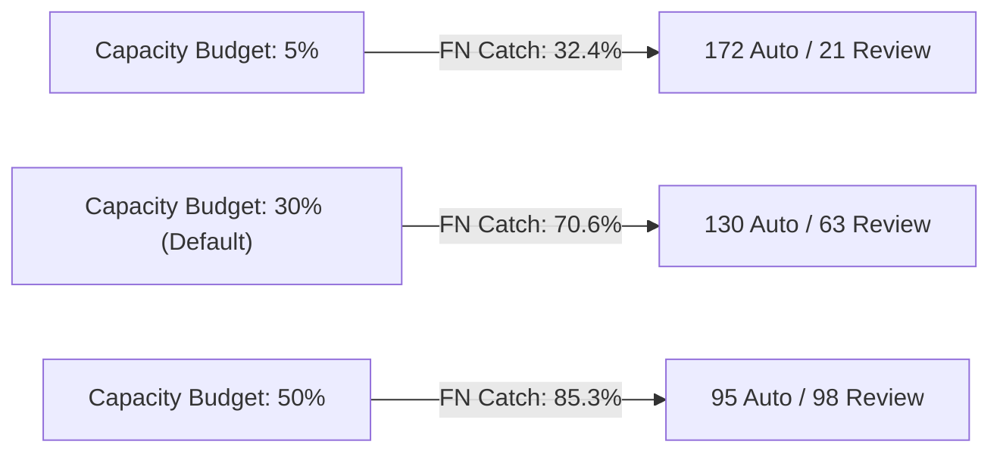

# Human Review Evaluation & Workload Policy Simulation

## 1. Critical Scientific & Regulatory Claim Boundary

> [!WARNING]
> **SIMULATION-ONLY CLAIM BOUNDARY**
> All evaluations, workload sweeps, and triage outcomes in this document are **offline mathematical simulations** based on synthetic models of human reviewer accuracy.
>
> **DO NOT CLAIM THAT A REAL HUMAN REVIEW PROCESS IMPROVES OUTCOMES UNLESS ACTUAL CLINICIANS HAVE EVALUATED THE SYSTEM IN A CONTROLLED PROSPECTIVE STUDY.**
>
> In real-world deployment, clinician-AI teaming is constrained by:
> 1. **Automation bias**: Clinicians becoming complacent when the model outputs "Automatic".
> 2. **Alert fatigue**: Excessive referral volumes causing clinicians to dismiss warnings.
> 3. **Cognitive variability**: Inter-radiologist disagreement and diagnostic fatigue during prolonged shifts.
> 4. **Workflow friction**: Delays in secondary specialist escalation.

---

## 2. Validation-Calibrated Capacity Sweep ($n=193$ Held-Out Test Cases)

The RAA decision policy dynamically maps clinical department review capacity (cases reviewed per 100 scans) to validation risk percentiles:
- $\text{Automatic Cutoff Percentile} = 100 - \text{Capacity}$
- $\text{Human Review Cutoff Percentile} = 100 - \frac{\text{Capacity}}{3}$

Below is the empirical behavior across capacity settings on the held-out test split:

| Capacity Budget (/100) | Valid. Cutoffs ($t_{\text{auto}} / t_{\text{assist}}$) | Automatic Tier Count (% share) | Assisted Tier Count (% share) | Human Review Count (% share) | Total Workload (Assisted + Human) | Automatic Tier Error Rate | False Negatives in Automatic | FN Catch Rate (Routed Away) |
|---|---|---|---|---|---|---|---|---|
| **5%** | $p95.0$ / $p98.3$ | 172 (89.1%) | 10 (5.2%) | 11 (5.7%) | 21 (10.9%) | 23.8% | 23 / 34 | 32.4% |
| **10%** | $p90.0$ / $p96.7$ | 161 (83.4%) | 13 (6.7%) | 19 (9.8%) | 32 (16.6%) | 21.7% | 17 / 34 | 50.0% |
| **15%** | $p85.0$ / $p95.0$ | 142 (73.6%) | 30 (15.5%) | 21 (10.9%) | 51 (26.4%) | 21.1% | 13 / 34 | 61.8% |
| **20%** | $p80.0$ / $p93.3$ | 137 (71.0%) | 33 (17.1%) | 23 (11.9%) | 56 (29.0%) | 20.4% | 12 / 34 | 64.7% |
| **25%** | $p75.0$ / $p91.7$ | 133 (68.9%) | 31 (16.1%) | 29 (15.0%) | 60 (31.1%) | 20.3% | 11 / 34 | 67.6% |
| **30% (Default)** | $p70.0$ / $p90.0$ | **130 (67.4%)** | **31 (16.1%)** | **32 (16.6%)** | **63 (32.6%)** | **20.0%** | **10 / 34** | **70.6%** |
| **40%** | $p60.0$ / $p86.7$ | 115 (59.6%) | 39 (20.2%) | 39 (20.2%) | 78 (40.4%) | 19.1% | 9 / 34 | 73.5% |
| **50%** | $p50.0$ / $p83.3$ | 95 (49.2%) | 48 (24.9%) | 50 (25.9%) | 98 (50.8%) | 16.8% | 5 / 34 | 85.3% |
| **60%** | $p40.0$ / $p80.0$ | 77 (39.9%) | 60 (31.1%) | 56 (29.0%) | 116 (60.1%) | 18.2% | 4 / 34 | 88.2% |

---

## 3. Offline Review Policy Simulations

To assess theoretical systemic error reduction, we simulated multiple hypothetical reviewer paradigms:

1. **Policy 1: Autonomous Baseline (0% Review Capacity)**
   - All 193 cases accepted autonomously without human oversight.
   - Net System Error Rate: **26.9%** (52 errors).
   - Unreviewed False Negatives: **34** (100% of errors reach clinical practice).
   - Review Workload: **0 cases**.
2. **Policy 2: Standard RAA ($30\%$ Capacity) + Perfect Reviewer Model**
   - Assumes human reviewer has 100% sensitivity and specificity on all 63 referred cases.
   - Net System Error Rate: **13.5%** (26 errors remaining in unreviewed Automatic tier).
   - Unreviewed False Negatives: **10** (70.6% reduction).
   - Review Workload: **63 cases** (32.6% of intake).
3. **Policy 3: Standard RAA ($30\%$ Capacity) + Realistic Imperfect Clinician Model**
   - Assumes clinician sensitivity of 90.0% and specificity of 92.0% on referred cases.
   - Net System Error Rate: **17.6%** (34 total systemic errors).
   - Unreviewed False Negatives: **10** (plus ~3 potential human misses on referred cases).
   - Review Workload: **63 cases**.
4. **Policy 4: Conservative RAA ($50\%$ Capacity) + Realistic Imperfect Clinician Model**
   - Assumes 50% of cases are escalated to Assisted or Human Review ($p50/p83$).
   - Net System Error Rate: **15.0%** (29 total systemic errors).
   - Unreviewed False Negatives: **5** (85.3% reduction in automated misses).
   - Review Workload: **98 cases** (50.8% of intake).

---

## 4. Key Takeaways for Clinical System Designers

1. **Non-Linear Catch Dynamics**: Increasing human review capacity from 5% to 30% produces a dramatic jump in false negative catch rate (from 32.4% to 70.6%). However, increasing capacity further from 30% to 60% yields diminishing marginal gains (70.6% to 88.2%) while doubling clinician workload.
2. **The 30/100 Default as a Prudent Optimum**: The standard $p70/p90$ threshold policy occupies the elbow of the workload-safety trade-off curve, capturing over 70% of false negatives while automating approximately two-thirds of cases.
3. **Simulation Caution**: In clinical reality, imperfect human review and automation bias mean net error rates will deviate from these theoretical numbers. Real-world validation remains irreplaceable.
