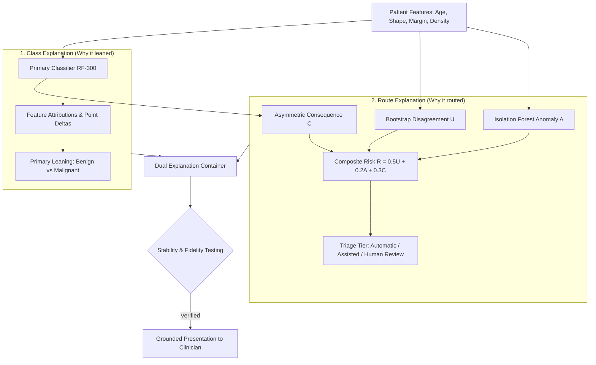

# Decoupled Explanations: Class Leaning vs. Routing Risk

## 1. Motivation: The Dual-Objective Dilemma

Standard explainable AI (XAI) frameworks generate a single attribution vector (e.g., standard SHAP or feature importance) explaining which features drove the classification score. In a **selective classification system with abstention**, this single explanation creates dangerous cognitive ambiguity:
- A clinician seeing a feature highlighted does not know whether that feature caused the model to **suspect malignancy**, or whether it caused the model to **abstain due to high uncertainty or unusual morphology**.
- Conflating prediction rationales with routing rationales violates epistemic honesty and degrades clinical decision support.

The Risk-Aware Abstention system introduces **Decoupled Explanations**, explicitly separating:
1. **The Class Explanation**: What clinical features influenced the model leaning toward Benign vs. Malignant.
2. **The Route Explanation**: What risk factors (uncertainty, anomaly, asymmetric consequence, or missingness) determined the triage tier (Automatic, Assisted, or Human Review).

---

## 2. Mathematical Formulation

### 2.1 Class Explanation (Local Sensitivity & Attribution)

Let $\hat{p}(\text{malignant} \mid \mathbf{x})$ be the model's malignant probability for input vector $\mathbf{x} = (x_1, \dots, x_d)$. For each feature $j \in \{1, \dots, d\}$, let $\tilde{x}_j$ denote the reference value estimated from the training cohort (median for continuous age, mode for categorical margin/shape/density).

The local counterfactual feature attribution is defined as:
$$\Delta p_j = \hat{p}(\text{malignant} \mid \mathbf{x}) - \hat{p}(\text{malignant} \mid \mathbf{x}_{-j}, \tilde{x}_j)$$

- **Magnitude** $|\Delta p_j|$ reflects the feature's local predictive impact.
- **Directional push** $\text{sign}(\Delta p_j)$ indicates whether the feature shifted the estimate toward malignant ($\Delta p_j > 0$) or toward benign ($\Delta p_j < 0$).
- Features are ranked in descending order of $|\Delta p_j|$ to surface the primary clinical driver.

### 2.2 Route Explanation (Risk Decomposition)

The composite risk score is governed by:
$$R(\mathbf{x}) = w_u \cdot \tilde{U}(\mathbf{x}) + w_a \cdot \tilde{A}(\mathbf{x}) + w_c \cdot \tilde{C}(\hat{y})$$
with canonical weights $w_u = 0.5, w_a = 0.2, w_c = 0.3$.

The Route Explanation decomposes $R(\mathbf{x})$ into exact percentage shares:
$$\text{Share}_k = \frac{w_k \cdot \text{Score}_k}{R(\mathbf{x})} \times 100\%$$

If an input feature is marked *"Not sure / not listed"*, an **epistemic missingness override** forces immediate escalation to Human Review regardless of the numerical value of $R(\mathbf{x})$.

---

## 3. Explanation Verification: Stability & Fidelity Diagnostics

Before presenting an explanation to a clinician, the system subjects it to two empirical verification gates:

### 3.1 Stability Testing
- **Hypothesis**: True explanatory signals should be robust to infinitesimal perceptual jitter; fragile attributions that flip under minor noise must not be presented as evidence.
- **Protocol**: Continuous features are perturbed across $N=15$ Gaussian jitter trials ($\sigma = 2\%$). The rank order of feature attributions is recorded.
- **Metric**: Mean Spearman rank correlation $\bar{\rho}_s$. An explanation passes if $\bar{\rho}_s \ge 0.80$.

### 3.2 Fidelity Testing (Faithfulness)
- **Hypothesis**: The top-attributed feature must exert a significantly larger causal influence on the model's output than non-attributed or average features.
- **Protocol**: The delta impact of the top feature $|\Delta p_{\text{top}}|$ is compared to the mean delta impact of remaining features $\frac{1}{d-1}\sum_{j \ne \text{top}} |\Delta p_j|$.
- **Metric**: Fidelity ratio $\Phi = \frac{|\Delta p_{\text{top}}|}{\bar{\Delta p}_{\text{other}}}$. An explanation passes if $|\Delta p_{\text{top}}| \ge \bar{\Delta p}_{\text{other}}$ ($\Phi \ge 1.0$).

---

## 4. Worked Example: Borderline Spiculated Lesion

To illustrate the separation, consider a 62-year-old patient with an irregular shape, spiculated margin, and high tissue density:

1. **Class Explanation**:
   - Model Lean: **Malignant** (confidence: 78.4%, estimated probability: 0.784).
   - Primary feature: **Mass edge (Spiculated)** (+34.2 percentage points toward malignant vs round reference).
   - Secondary feature: **Mass shape (Irregular)** (+18.5 percentage points toward malignant).
2. **Route Explanation**:
   - Triage Tier: **Assisted Review** ($R = 0.521 > t_{70} = 0.485$, but $\le t_{90} = 0.612$).
   - Primary Risk Contributor: **Clinical Consequence (38.4% of total risk)** due to malignant probability proximity to the decision threshold.
   - Secondary Risk Contributor: **Bootstrap Disagreement (34.1% of total risk)** reflecting tree disagreement across borderline dense tissue features.
3. **Verification Diagnostics**:
   - Stability: Passed ($\bar{\rho}_s = 0.942 \ge 0.80$).
   - Fidelity: Passed ($\Phi = 2.45\text{x}$ top-feature dominance).
   - Outcome: **Evidence Valid for Clinical Review.**
